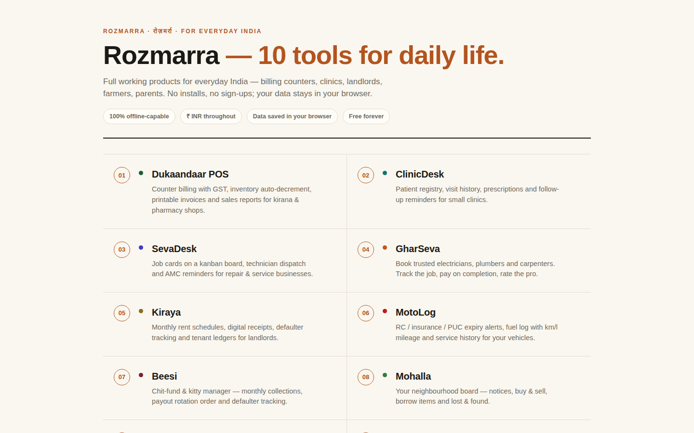
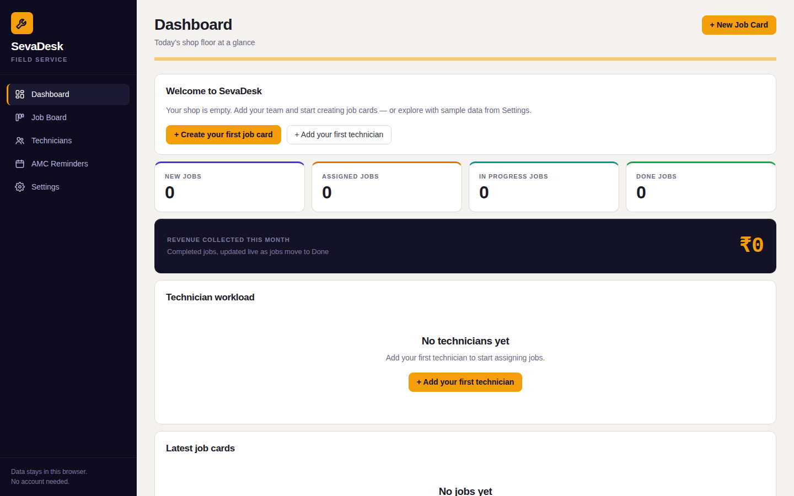
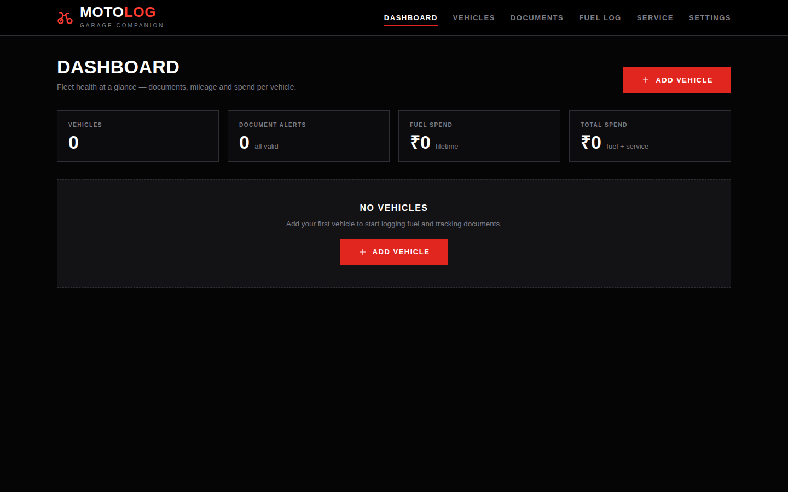

<div align="center">

# रोज़मर्रा · Rozmarra

### Everyday tools for everyday India.

Ten full working products for the life you actually live — the kirana counter, the clinic, the landlord's ledger, the bike in your parking, the beesi group, the mohalla board. No installs. No sign-ups. No servers watching. Your data stays in your browser.

**[→ Open Rozmarra](https://shoelee22.github.io/rozmarra/)**



</div>

---

## The ten tools

| # | Tool | What it does | Open |
|---|------|--------------|------|
| 01 | **Dukaandaar POS** | Counter billing with GST, inventory auto-decrement, printable invoices & sales reports for kirana & pharmacy shops | [dukaandaar-pos](https://shoelee22.github.io/rozmarra/dukaandaar-pos/) |
| 02 | **ClinicDesk** | Patient registry, visit history, prescriptions & follow-up reminders for small clinics | [clinicdesk](https://shoelee22.github.io/rozmarra/clinicdesk/) |
| 03 | **SevaDesk** | Job cards on a kanban board, technician dispatch & AMC reminders for repair & service businesses | [sevadesk](https://shoelee22.github.io/rozmarra/sevadesk/) |
| 04 | **GharSeva** | Book trusted electricians, plumbers & carpenters — track the job, pay on completion, rate the pro | [gharseva](https://shoelee22.github.io/rozmarra/gharseva/) |
| 05 | **Kiraya** | Monthly rent schedules, digital receipts, defaulter tracking & tenant ledgers for landlords | [kiraya](https://shoelee22.github.io/rozmarra/kiraya/) |
| 06 | **MotoLog** | RC / insurance / PUC expiry alerts, fuel log with km/l mileage & service history for your vehicles | [motolog](https://shoelee22.github.io/rozmarra/motolog/) |
| 07 | **Beesi** | Chit-fund & kitty manager — monthly collections, payout rotation order & defaulter tracking | [beesi](https://shoelee22.github.io/rozmarra/beesi/) |
| 08 | **Mohalla** | Your neighbourhood board — notices, buy & sell, borrow items, lost & found | [mohalla](https://shoelee22.github.io/rozmarra/mohalla/) |
| 09 | **Parivar Care** | Daily check-ins, medicine reminders & one-tap SOS for elderly parents living alone | [parivar-care](https://shoelee22.github.io/rozmarra/parivar-care/) |
| 10 | **KisanSetu** | Daily mandi prices, farm expense log & sarkari scheme deadlines for farmers | [kisansetu](https://shoelee22.github.io/rozmarra/kisansetu/) |

## A look inside

**SevaDesk** — the repair shop's mission control, clean even on day one:



**MotoLog** — your garage companion, waiting for its first vehicle:



## How to use

1. Open any tool above — it starts clean, ready for *your* data.
2. Add your first entry (vehicle, patient, tenant…). Everything saves automatically in your browser.
3. Curious first? Go to **Settings → Load sample data** to explore with realistic data, then **Clear all data** to start fresh.

## Why it works this way

- **Private by design** — every tool runs 100% in your browser via `localStorage`. No accounts, no backend, no tracking, nothing to leak.
- **Offline-capable** — once loaded, the tools work without internet.
- **Real money, real units** — ₹ INR throughout, Indian phone formats, DD-MMM-YYYY dates.
- **Honest software** — what you see is what it does. No fake buttons, no placeholder screens.

## Run it yourself

It's static files — no build step, no dependencies:

```bash
git clone https://github.com/Shoelee22/rozmarra.git
cd rozmarra
python3 -m http.server 8000
# open http://localhost:8000/
```

Deploy anywhere static hosting works: GitHub Pages, Vercel, Netlify, Cloudflare Pages.

## For developers

Each tool is vanilla HTML/CSS/JS in its own folder with a `?selftest=1` harness — it wipes, seeds, scripts the full user flow, asserts persistence, and reports PASS/FAIL. Every tool ships with its self-test green and zero console errors.

```
rozmarra/
├── index.html          # hub page
├── screenshots/        # the images above
├── dukaandaar-pos/
├── clinicdesk/
├── sevadesk/
├── gharseva/
├── kiraya/
├── motolog/
├── beesi/
├── mohalla/
├── parivar-care/
└── kisansetu/
```

---

<div align="center">

*रोज़मर्रा — for the everyday.*

</div>
